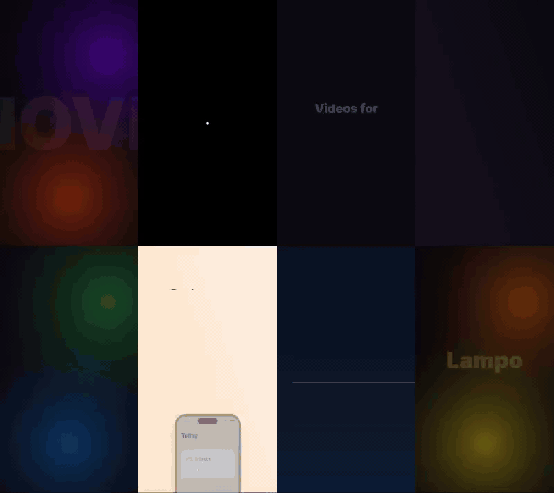
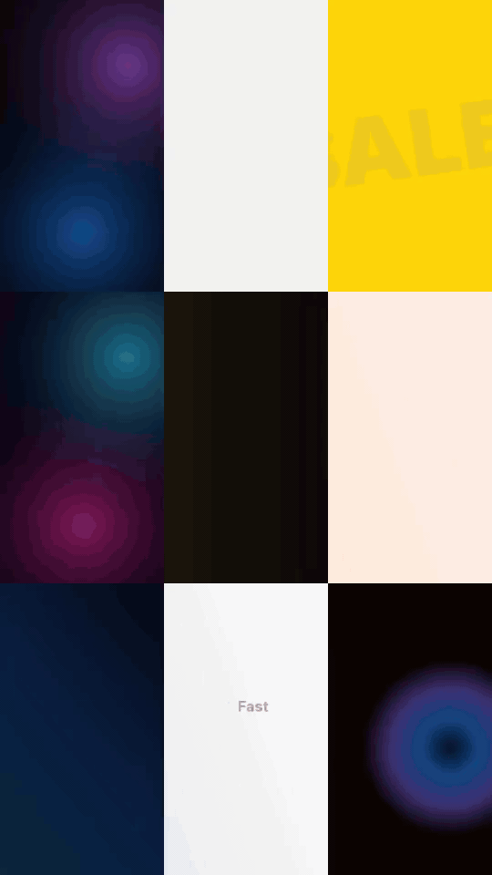

<div align="center">

# ⚡ Lampo

**Motion graphics from JSON, built for AI agents.**
Ads, reels, TikToks, product launches and animated titles — rendered in seconds, without a browser.

Works as a **Claude Code plugin**, a **Gemini CLI extension**, an **MCP server** (Claude Desktop, Cursor, Codex, ChatGPT) and a **CLI / Node library**.

[](https://github.com/bossartemii/lampo/stargazers) &nbsp; [](LICENSE)

[Website](https://bossartemii.github.io/lampo/) · [**Playground**](https://bossartemii.github.io/lampo/playground/) · [Gallery](#gallery) · [Quick start](#quick-start) · [Why it's fast](#why-its-fast) · [Spec reference](src/guide.md) · [Examples](examples/) · [Italiano](README.it.md)

 &nbsp; 

<sub>Each video above is one JSON file: <a href="examples/showreel.json">showreel.json</a> (17 s, rendered in ~10 s) · <a href="examples/coffee.json">coffee.json</a> (2.3 KB) · the sound version is on the <a href="https://bossartemii.github.io/lampo/">website</a></sub>

</div>

---

## The idea

Today an AI agent that makes a video writes hundreds of lines of HTML, CSS and GSAP (HyperFrames) or React (Remotion), then a headless Chrome takes a screenshot of every frame. It works, but it's slow, and agents break animations, timing and layout all the time.

Lampo flips it around. The agent writes a short JSON spec with **named effects** (`"in": "rise"`, `"transition": "zoom"`). All the motion design lives in a tested engine that draws frames directly with **Skia** (the graphics library inside Chrome, without Chrome), splits the video across CPU cores and encodes in parallel.

```json
{
  "format": "9:16",
  "scenes": [
    {
      "duration": 3,
      "background": { "type": "glow", "colors": ["#B45309", "#F59E0B"] },
      "layers": [
        { "text": "Monday?", "size": 190, "weight": 900, "in": "zoomOut" },
        { "text": "We've got **you**.", "size": 80, "y": "55%", "in": { "effect": "wordsUp", "delay": 0.6 } }
      ]
    },
    {
      "duration": 3, "transition": "zoom",
      "layers": [ { "type": "counter", "to": 1240, "suffix": " cups", "size": 170, "in": "popIn" } ]
    }
  ]
}
```

## Playground

**[Try it in the browser →](https://bossartemii.github.io/lampo/playground/)** Write a spec, watch it play with sound as you type, and download the video. It's the real Lampo engine (the same `src/` as the CLI) bundled for the browser and encoded with WebCodecs: MP4 in Chrome, Edge and Safari, WebM in Firefox. Nothing is uploaded. Pick any example, blueprint or style as a starting point, and share a spec with a link.

## Gallery

### 16 shot blueprints
Time-coded scene templates with a signature move and ready JSON — the agent copies one per scene and swaps the copy.


<sub>kinetic-slam · morph-lockup · ticker-takeover · stat-hit · grid-assemble · app-demo · camera-pan · cta-press — all 16 with JSON in <a href="skills/lampo/references/blueprints.md">blueprints.md</a></sub>

<table>
<tr>
<td width="50%" valign="top">

### 9 visual styles
Keynote Glow · Swiss Pulse · Bold Poster · Neon Night · Velvet Luxury · Soft Pastel · Data Drift · Mono Motion · Street Warm.

Each style fixes palette, type, effects, transitions and sound, so the whole video reads as one designed system. Brand colors and fonts swap in; the motion rules stay. Specs in [visual-styles.md](skills/lampo/references/visual-styles.md).

### Landscape too


<sub><a href="examples/launch.json">launch.json</a>, 4 scenes, ~50 lines</sub>

</td>
<td width="50%" valign="top"></td>
</tr>
</table>

### 42 synthesized sounds
`"sfx": true` puts a sound on every entrance, transition, tap and counter, on the exact frame — whoosh, flyby, riser, reverse, pop, tap, keyboard, success, cash, shutter, impact, slam, drop, kick, snare, magic, sparkle and more. No audio files, no licensing. **[▶ Listen to all 42](docs/media/sfx.mp4)** (or on the [website](https://bossartemii.github.io/lampo/#sound)).

## A motion designer inside your agent

The Lampo skill (Claude Code, Gemini CLI, or `lampo_guide` topics for any MCP client) doesn't just hand the agent a reference, it directs the video:

1. **Route** — what kind of video is this? Social ad, product launch, app walkthrough, explainer, beat promo, brand sting… (8 routes with length, scenes and copy structure)
2. **Style** — one of the 9 looks above, or the brand's colors with that style's motion rules
3. **Shot plan** — one blueprint per scene, one continuity moment (a morph, a color takeover, a shove), where the riser ends and the boom lands
4. **Build** — the spec, following motion rules: varied easing and timing, staggered by importance, three layers per scene, fill the frame
5. **Look and fix** — `lampo_preview` returns proof frames as an image in ~1 s; a checklist catches cut text, empty frames and repetitive motion
6. **Render** — the MP4, plus one suggested variation

## Why it's fast

**Render speed.** Same 10.9 s ad, 1080×1920 @ 30 fps, on a 2-core machine:

| Pipeline | Time | |
|---|---|---|
| Browser method — headless Chrome + per-frame screenshot + ffmpeg (the pipeline behind Remotion and HyperFrames) | **53.4 s** | |
| Lampo, `standard` quality | **13.7 s** | ~3.9× faster |
| Lampo, `draft` quality (540×960, for iterating) | **3.0 s** | ~18× faster |

The comparison reproduces the underlying browser pipeline, not those tools themselves — run it yourself with [`bench/browser-baseline.js`](bench/browser-baseline.js). Lampo does more work in that test (scene transitions, counter, typewriter). More cores = bigger gap, because chunks render in parallel.

**Agent speed** — the part that matters most:

- **Less to write.** The demo ad is 2.3 KB of JSON; the HTML/CSS equivalent is 3.9 KB *without* transitions or the counter. Fewer tokens, fewer bugs.
- **Errors written for agents.** `effect "flyIn" does not exist. Effects: fade, fadeUp, …` — fixed on the first retry. Lenient JSON parsing (comments, trailing commas).
- **The agent can see.** `lampo_preview` returns a keyframe contact sheet as an image in ~1 s, so the agent catches overlaps and cut-off text before rendering.
- **Safe by default.** Text that doesn't fit is scaled down automatically; counters size themselves on the final value.

| | Lampo | HyperFrames | Remotion |
|---|---|---|---|
| Agent writes | JSON with named effects | HTML + CSS + GSAP | React (TSX) |
| Renderer | Skia, no browser | Headless Chrome | Headless Chrome |
| Visual preview for the agent | Built in (MCP image) | Browser / render | Studio / render |
| License | Apache 2.0 | Apache 2.0 | Paid company license above 3 people |
| Arbitrary HTML/CSS | ✗ (the price of speed) | ✓ | ✓ (JSX) |
| Distributed cloud rendering | Single machine (for now) | Single machine | ✓ Lambda |

## Quick start

Requires **Node 18+**. ffmpeg comes bundled (`ffmpeg-static`) or uses your system one. On Android (Termux) run `pkg install nodejs ffmpeg` first.

```bash
git clone https://github.com/bossartemii/lampo && cd lampo && npm install
npx lampo init my-ad             # starter spec
npx lampo preview my-ad.json     # keyframe sheet (PNG)
npx lampo render my-ad.json      # → my-ad.mp4
```

### Claude Code — plugin (skill + MCP)
```
/plugin marketplace add bossartemii/lampo
/plugin install lampo@lampo
```
Then just ask: *"make a 15-second vertical ad for my bakery"*.

### Gemini CLI — extension (skill + MCP)
```bash
gemini extensions install https://github.com/bossartemii/lampo
```

### Claude Desktop, Cursor, Windsurf, any MCP client
```json
{ "mcpServers": { "lampo": { "command": "node", "args": ["/path/to/lampo/mcp/launch.js"] } } }
```

### OpenAI Codex CLI — `~/.codex/config.toml`
```toml
[mcp_servers.lampo]
command = "node"
args = ["/path/to/lampo/mcp/launch.js"]
```

### ChatGPT and Claude.ai — Lampo Cloud
No install for the user: one HTTPS server renders for everyone. Deploy it for free on **Hugging Face Spaces** (three files to upload, in `cloud/huggingface-free/`), or on Fly.io, Render or any Docker host (`fly.toml`, `render.yaml`, `Dockerfile`), create keys with credits, and connect:

- **Claude.ai / ChatGPT**: add a connector with the URL `https://your-host/mcp/lk_…`
- **Claude Code, Cursor, Codex**: `https://your-host/mcp` with `Authorization: Bearer lk_…`
- **Apps and the playground**: `POST /api/render { "spec": … }` → a signed MP4 link

Keys, credits, limits, signed download links and media restricted to public https URLs are built in. Full guide: **[CLOUD.md](CLOUD.md)**.

## MCP tools

| Tool | What it does |
|---|---|
| `lampo_guide` | Full spec reference. `topic`: `routes`, `styles`, `blueprints`, `motion`, `review` for motion-design direction. |
| `lampo_preview` | Keyframe contact sheet as an image (~1 s) |
| `lampo_still` | One full-resolution frame as an image |
| `lampo_validate` | Checks a spec, returns fixable errors |
| `lampo_render` | Renders the MP4, returns path, stats and (HTTP mode) a download URL |

## What's inside

- **Motion-design skill** (like a director in the agent): 8 video routes, 9 named visual styles, 16 time-coded blueprints with ready JSON (kinetic slam, morph lockup, ticker takeover, camera pan, app demo…), motion rules and a visual review loop — `skills/lampo/`, also via `lampo_guide` topics
- **Formats** 9:16, 1:1, 4:5, 16:9 or custom · 1–120 fps · draft / standard / high
- **Layers** text (with `**highlights**`, gradients, stroke, pill buttons, auto-fit), counter (locale-aware), rect, circle, line, image, **video clips** (trim, slow motion, loop, rounded corners, optional clip audio)
- **Motion design**: shapes that **morph** (dot → line → pill → app icon → full screen) with keyframed size, radius and color, circle takeovers, an **iris transition**, **RGB glitch** text, **25 line icons** (also inline with text), a loading **spinner**, `rush` speed-blur entrances
- **App & website demos**: an iPhone mockup whose screen you lay out in real iPhone points, groups for cards/buttons/screens, a **touch cursor** that glides and taps with ripples, **keyframes** for camera moves and button presses, **hand-drawn paths** that draw themselves (underline, circle, arrow, check, any SVG), and a **stamp** effect
- **44 enter/exit effects** incl. `glitch`, `rush`, `stamp`, `draw`, `iris`, `flip`, `elastic`, `swing`, `skewIn`, `flicker`, `focus`, `unfold`, `rise` (keynote-style line masks), `wordsRise`, `wordsUp`, `letters`, `lettersBlur`, `cascade`, `typewriter`, `blurIn`, `zoomOut`, `popIn`, `grow`
- **14 loops** float, pulse, rotate, kenburns, drift, shake, breathe, wiggle, swing, bounce, orbit, heartbeat, flicker, glitch · **9 easings** + cubic-bezier
- **19 transitions** fade, slide, slideUp, slideDown, push, pushUp, whip, zoom, zoomIn, wipe, wipeLeft, wipeUp, wipeDown, barn, blur, circle (iris), fadeBlack, flash, none
- **Backgrounds** solid, animated gradient, `glow` (soft drifting light), image with Ken Burns, **b-roll video**
- **Sound effects** synthesized by Lampo and synced to the animations automatically (`"sfx": true`): 42 sounds (whoosh, flyby, riser, reverse, pop, tap, keyboard, success, cash, shutter, impact, slam, drop, kick, snare, magic, sparkle…) — no audio files, no licensing
- **Audio** with fades · **custom fonts** · **global layers** (logo, watermark) · vignette

Full reference: [`src/guide.md`](src/guide.md) · Examples: [`examples/`](examples/) (Italian ones in [`examples/it/`](examples/it/))

## Roadmap

- [x] Sound effects synced to the animations
- [x] Video clips as layers and b-roll backgrounds
- [x] App & website demos: phone mockup, touch cursor, keyframes, hand-drawn paths
- [x] Motion design: shape morphing, circle takeovers, glitch, icons, spinner
- [x] Motion-design skill: routes, styles, blueprints, review loop
- [x] 42 synthesized sounds
- [ ] Auto-captions from audio (Whisper)
- [ ] Template packs per industry (restaurants, real estate, gyms, SaaS)
- [x] **Lampo Cloud** server — MCP over HTTPS for ChatGPT and Claude.ai, REST API, keys and credits, one-file deploy ([CLOUD.md](CLOUD.md))
- [x] **Playground** — JSON in, video out, in the browser
- [ ] Public hosted Lampo Cloud instance

## Support the project

Lampo is free and open source. If it saves you time:

- ⭐ **Star the repo** — it's how others find it
- 💛 **[Sponsor on GitHub](https://github.com/sponsors/bossartemii)**
- ☁️ **Lampo Cloud & custom templates** — [open an issue](https://github.com/bossartemii/lampo/issues/new?title=Lampo%20Cloud%20early%20access&labels=cloud) to join early access

## Development

```bash
npm test                          # smoke test: every effect, transition, sound, image, audio + every skill snippet
node scripts/build-media.js       # rebuild the README GIFs and the website videos from the specs
node scripts/build-web.js         # rebuild the playground (engine bundle + examples) in docs/playground
node bench/browser-baseline.js    # benchmark vs the browser pipeline (needs puppeteer)
./scripts/build-skill.sh          # copy src/guide.md into skills/lampo/references/spec.md
```

```
src/          engine: spec (validation) · frame (drawing) · effects · render (parallel)
mcp/          server.js (stdio + HTTP / Lampo Cloud, zero deps) · launch.js (installs the engine on first run)
web/          browser shims + entry for the playground bundle
docs/         website and playground (GitHub Pages)
cli/          command line
skills/lampo/ SKILL.md + references/ (routes, styles, blueprints, motion rules, review) for Claude Code and Gemini CLI
```

Contributions welcome — new effects live in [`src/effects.js`](src/effects.js) and are a few lines each.

## License

[Apache 2.0](LICENSE) © Dimitri Artemii
